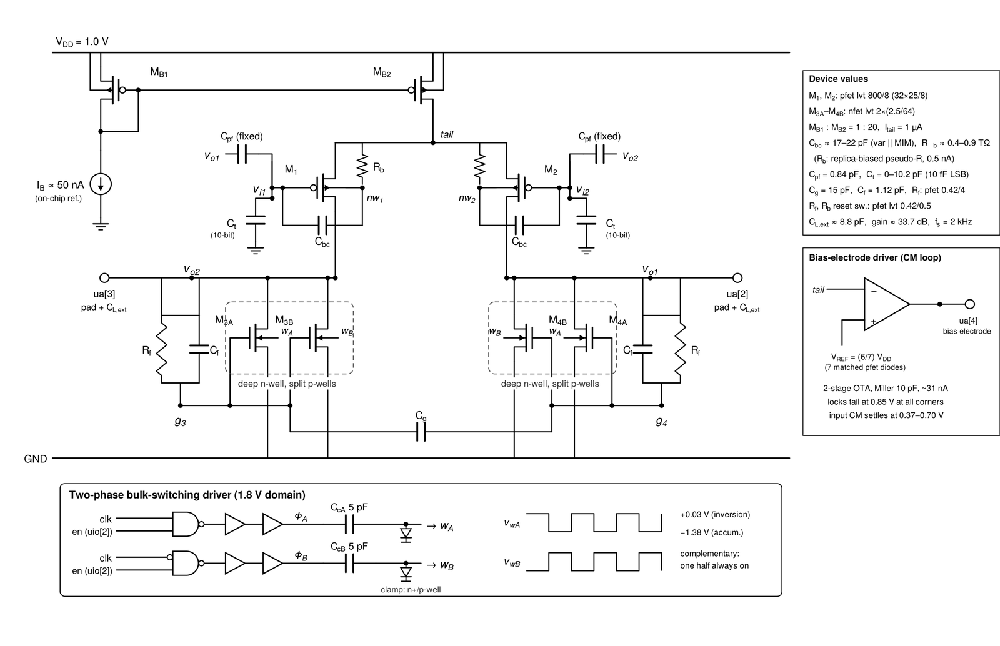
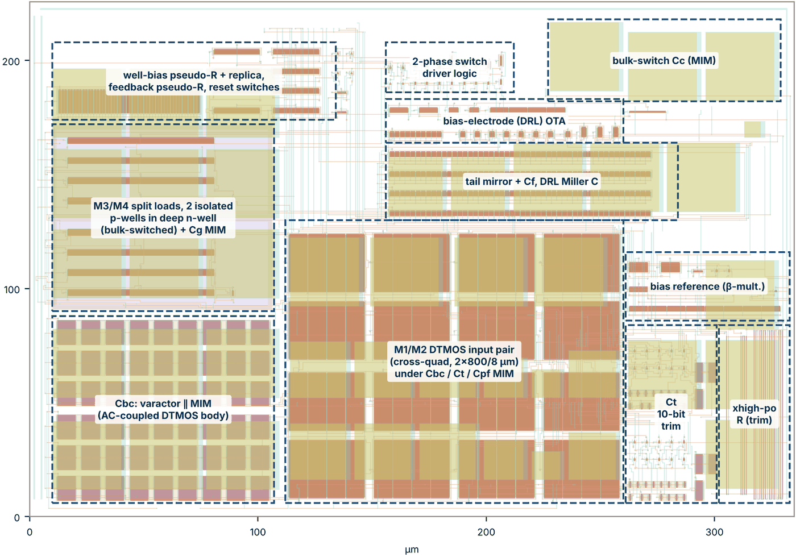

<!---
This file is used to generate your project datasheet.
-->

## How it works

A differential-difference ECG front end that runs from **1.0 V at about 1 µW**, with **0.9–1.0 µVrms input noise (0.5–150 Hz)** and **more than 2 GΩ input impedance** after trim.

To our knowledge, it is the first amplifier to combine two techniques:

- **Two-phase complementary bulk switching of the loads.** M3/M4 are each split into two halves that sit in two isolated p-wells inside a deep n-well. The p-wells are driven in antiphase at 2 kHz through 5 pF capacitors. Each half alternates between inversion and accumulation, which resets its oxide traps and suppresses 1/f noise, while the other half always conducts.
- **An AC-coupled DTMOS input pair.** The body of each pfet_lvt input device (800/8 µm) follows its gate in band through Cbc (varactor ∥ MIM, about 20 pF). A replica-biased pseudo-resistor sets the body at DC. This keeps the DTMOS gm boost with zero DC input current.

The rest of the design:

- **Gain:** set by Cg/Cf to about 33.7 dB, with pseudo-resistor feedback (high-pass corner in the mHz range). The low-pass corner is about 2.5 kHz with 8.8 pF at each output.
- **Input impedance:** a fixed positive-feedback capacitor Cpf (0.84 pF) over-neutralizes the input capacitance. A 10-bit input-node trim Ct (10 fF LSB) brings it back to zero net capacitance. Because the trim sits at the input node, its step is not multiplied by the gain.
- **Bias-electrode driver** on `ua[4]`: a two-stage OTA that holds the input-pair tail at 6/7·VDD, which sets the input common mode through the body.
- **Bias reference:** an on-chip subthreshold beta multiplier, about 50 nA, with a 2-bit trim (`IT[1:0]`) and self start-up.
- **Reset:** switches clear all the high-impedance nodes while `RST` is high.

## How to test

1. Apply **1.0 V to `ua[5]`**, with 100 nF decoupling at the pin. Put **8.8 pF from each output** (`ua[2]`, `ua[3]`) to ground.
2. Connect the signal electrodes to `ua[0]`/`ua[1]` and the bias (right-leg) electrode to `ua[4]`.
3. Hold **`RST` high for at least 20 ms** after power-up and after any saturation. Release it on the ECG baseline.
4. Set **`EN` = 1** and apply a **2 kHz clock** on `clk`.
5. Trim once per board:
   - Set `IT[1:0]` for about 1 µA total from `ua[5]`.
   - Find `CT[9:0]` by maximizing the gain measured through a 500 MΩ ∥ 22 pF source.
6. Read the differential output `ua[2]` − `ua[3]`.

Simulated performance over 5 process corners and 0–60 °C (post-layout, extracted capacitance back-annotated, TinyTapeout 500 Ω / 5 pF pin path included):

| Parameter | Value |
|---|---|
| Gain | 32.9–34.0 dB |
| Input noise, 0.5–150 Hz, switching on | 0.89–1.00 µVrms |
| Input impedance, 0.5–150 Hz | ≥ 2.25 GΩ (20–92 GΩ at 50 Hz) |
| Supply | ≈ 1.0–1.2 µA at 1.0 V, plus ~12 nA at 1.8 V |

## External hardware

- Analog-capable TinyTapeout demo board.
- 1.0 V low-noise supply for `ua[5]`, with 100 nF decoupling at the pin.
- 2 × 8.8 pF capacitors from the outputs to ground.
- ECG electrodes: two signal electrodes plus one bias electrode.
- A differential acquisition front end or ADC; the RP2040 can drive `clk`, `RST`, `EN` and the trim bits.
